# REDCORE BOOSTER

A gaming control center for Android phones: a game library, real performance modes, a floating in-game toolkit, live hardware monitoring and device research. It's built with Kotlin and Jetpack Compose and runs in landscape like a gaming phone's built-in game space.

REDCORE only shows real readings and only performs actions that Android allows. If a phone doesn't expose something, the app says so instead of showing a made-up number or a switch that does nothing.


| | |
|---|---|
| 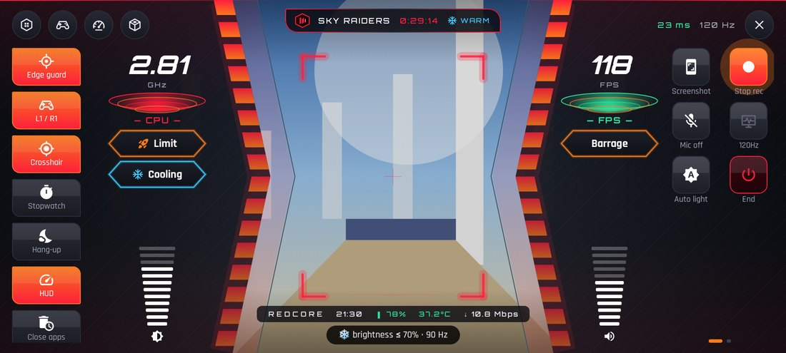 | 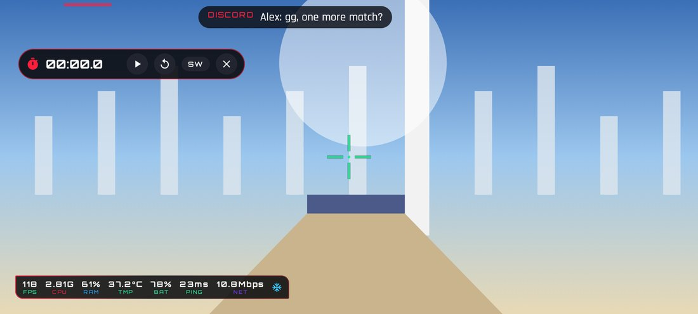 |
| 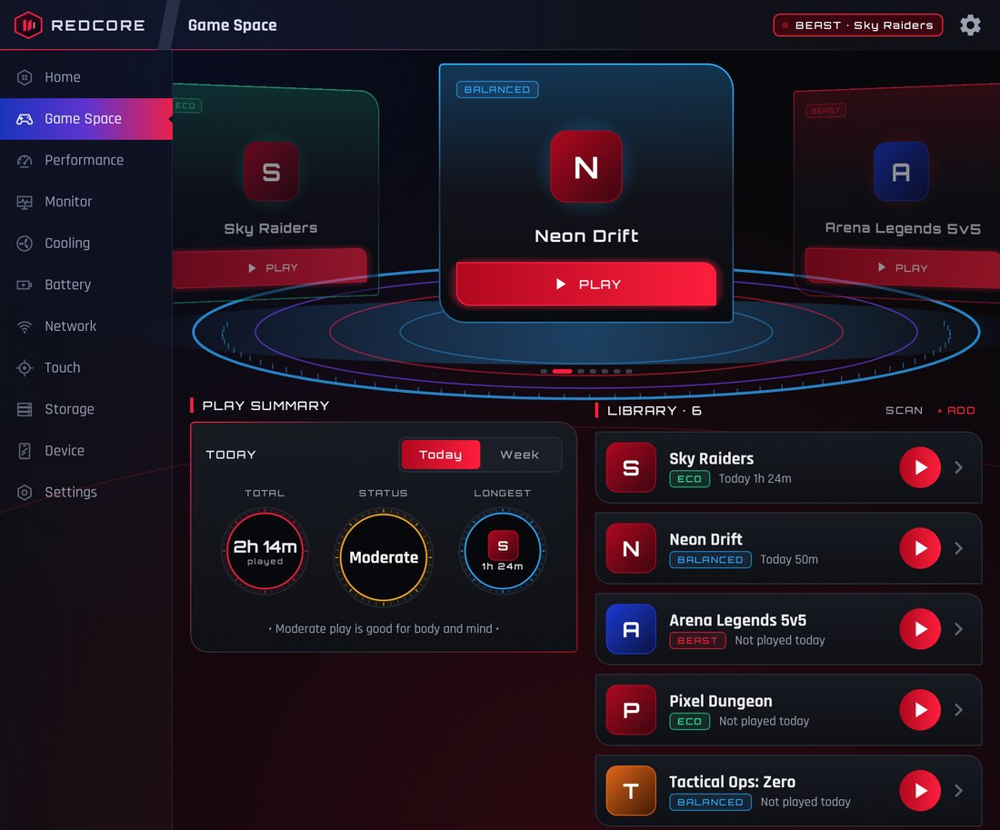 |  |
| 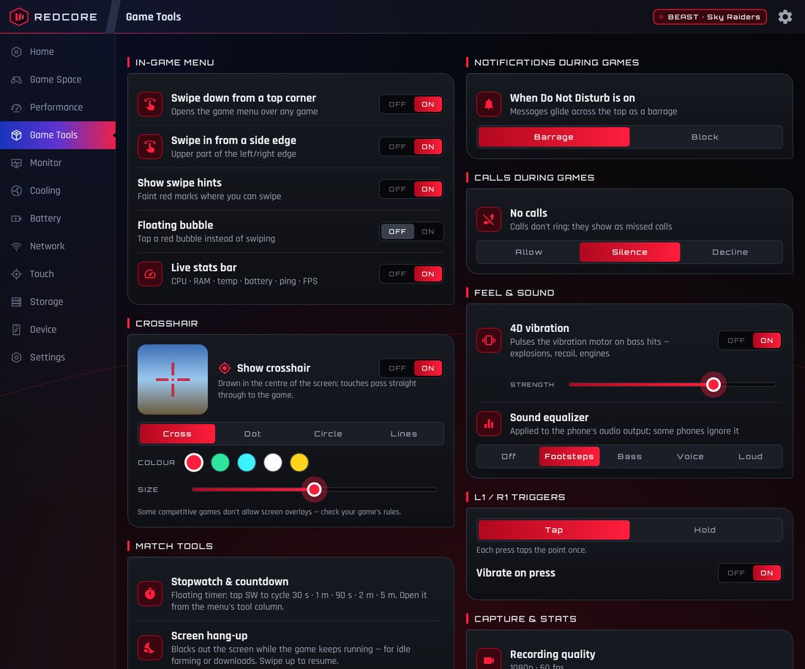 |  |
| 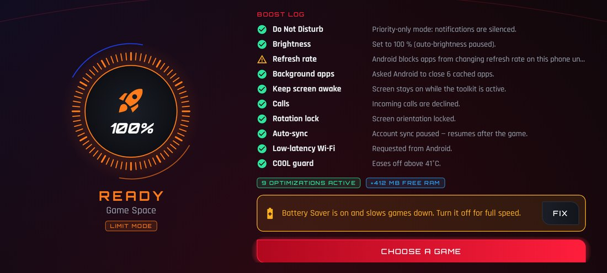 | 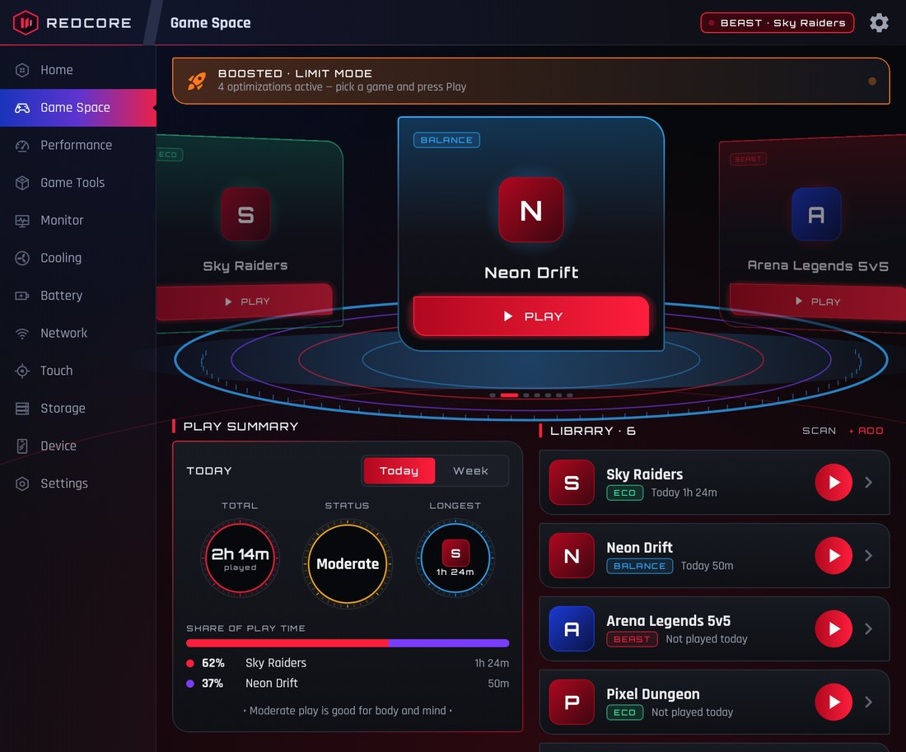 |
| 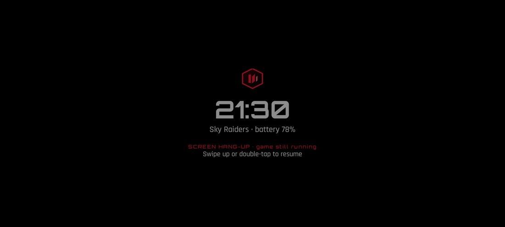 | 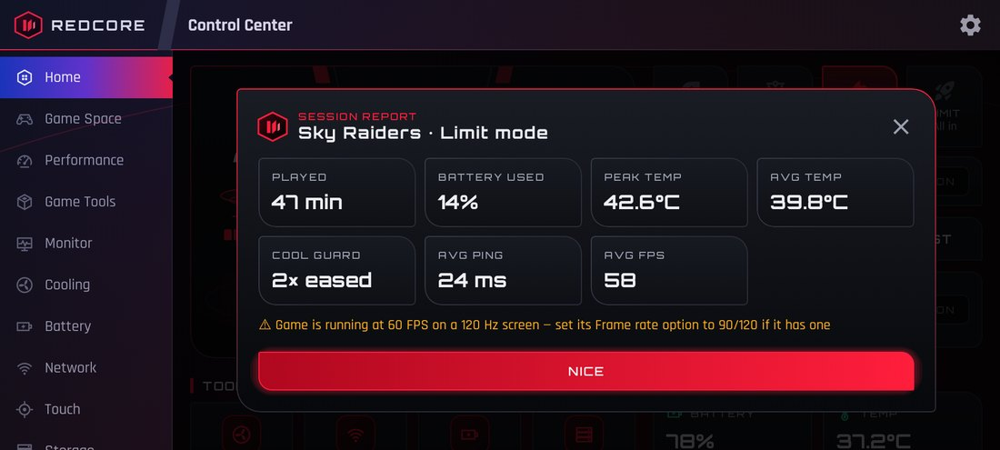 |
|  |  |
| 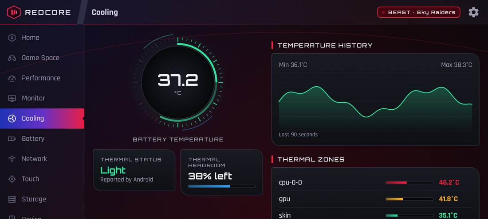 | 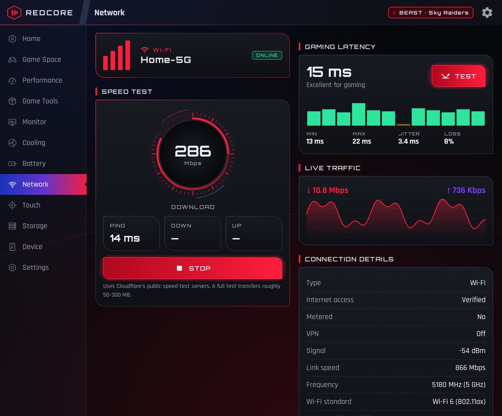 |
|  | 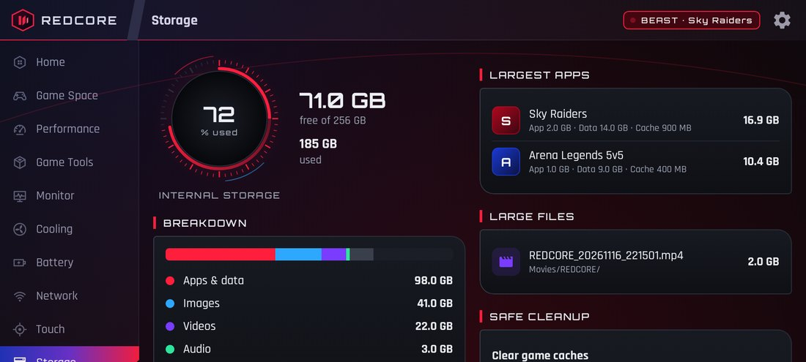 |
| 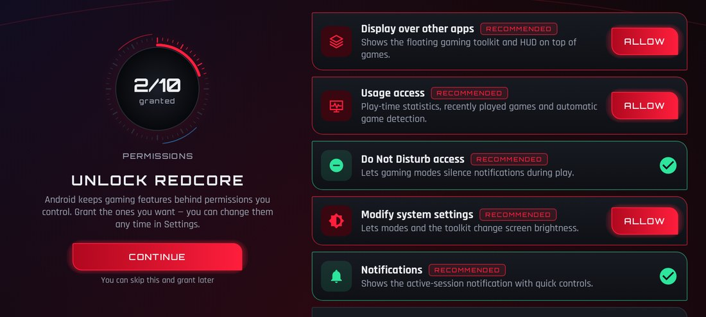 | 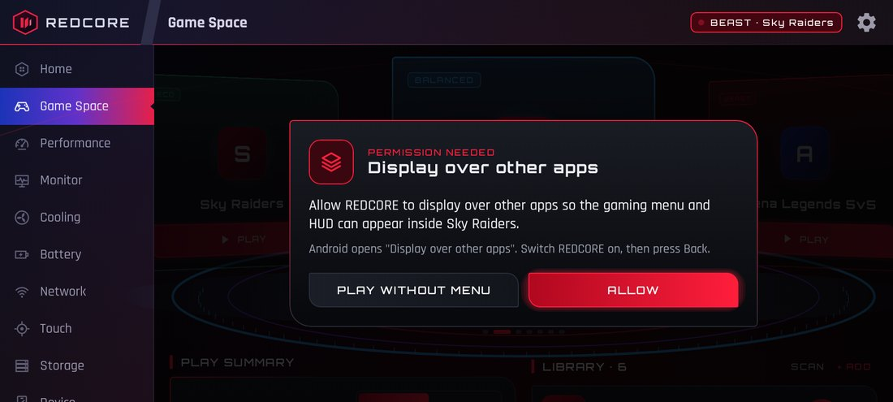 |

## Features

| Screen | What it does |
|---|---|
| **Control Center** | Live CPU clock and RAM stage, mode selector, quick status, toolbox, recently played games. |
| **Game Space** | 3D game carousel on a neon stage. Finds installed games automatically, and you can add or remove any app. Shows Today/Week play summary rings and a weekly bar chart. Each game has its own profile. |
| **Performance** | CPU and GPU rings, **Eco / Balance / Beast / Limit** modes, **COOL guard**, a per-action plan showing what each mode will do and whether it's allowed, results of the active session, background app cleanup, recommendations. |
| **Game Tools** | Side-swipe settings, crosshair designer, stopwatch & countdown, screen hang-up, barrage notifications, no calls, 4D vibration, sound EQ, L1/R1 tap/hold, recording quality, ping/FPS, break reminder, your phone's own game software. |
| **In-game menu** | **Swipe in from the left or right side edge** (or tap the optional bubble / stats bar) and side panels spring in behind animated chevron bands while the game stays visible in a glowing frame. Left: CPU readout, mode chip (cycles Eco→Limit), COOL chip, brightness bar, tools (edge guard, L1/R1, crosshair, stopwatch, hang-up, HUD, close apps). Right: FPS/GPU/RAM readout, notification mode (All / Barrage / Block), volume bar and two pages of tiles (screenshot, record, mic, refresh rate, auto brightness, rotation lock, no calls, 4D vibration, EQ). Top: game, session timer, COOL state. Tap the game to close it. |
| **Live stats bar** | Draggable pill with FPS (when available), CPU, RAM, temperature, battery, ping and network speed. |
| **Floating tools** | Crosshair (touches pass through), stopwatch/countdown, barrage notification line, screen hang-up (black screen while the game keeps running). |
| **Monitor** | Per-core CPU clocks, memory, temperature and network charts, GPU info, and an honest note about FPS. |
| **Cooling** | Temperature gauge, Android thermal status and headroom, history graph, readable thermal zones, fan detection (never a fake fan switch). |
| **Battery** | Level ring, temperature, voltage, current, power, cycles, design capacity, live charts, recommendations. |
| **Network** | Wi-Fi details, a real speed test (Cloudflare), TCP latency/jitter/loss test, live traffic, fixes. |
| **Storage** | Space by category, largest apps, largest media files, safe cleanup guidance. Nothing is deleted automatically. |
| **Touch** | Multi-touch tester that measures the real report rate. **Edge touch guard**: an overlay that blocks palm touches on the side edges during games. **L1/R1 triggers**: Volume −/+ tap two points you choose during game sessions. |
| **Device** | Manufacturer, model, codename, Android/SDK, kernel, chipset, cores and clusters, GPU renderer, OpenGL ES/Vulkan, memory, display modes and refresh rates, battery, storage, sensors, features. |
| **Settings** | Default mode, auto game boost, restore-after-play, toolkit options, units, permission center, limitations. |

### Gaming modes: what they really do

| Action | Eco | Balance | Beast | **Limit** | Requirement |
|---|---|---|---|---|---|
| Do Not Disturb (game sound & alarms stay on) | – | ✓ | ✓ | ✓ | Do Not Disturb access |
| Calls | your choice | your choice | your choice | **declined** | DND / Call blocking |
| Brightness (locked) | 40 % | unchanged | 100 % | 100 % | Modify system settings |
| Refresh rate | lowest | default | highest | highest | One-time ADB grant |
| Rotation lock | ✓ | ✓ | ✓ | ✓ | Modify system settings |
| Pause account auto-sync | – | ✓ | ✓ | ✓ | – |
| Low-latency Wi-Fi | – | ✓ | ✓ | ✓ | – (phone dependent) |
| Close recently used apps | – | – | ✓ | ✓ | Usage access |
| Keep screen awake | – | ✓ | ✓ | ✓ | Display over other apps |
| Faster system animations (0.5×) | – | – | – | ✓ | One-time ADB grant |
| Edge guard / L1-R1 / 4D vibration / EQ | if enabled | if enabled | if enabled | if enabled | Overlay / accessibility / mic |

Each game can override the main settings. When the session ends, Do Not Disturb policy, brightness, rotation, sync, refresh rate and animation speeds are restored.

### COOL guard

COOL guard works together with any mode, including Limit. During a session it watches the battery temperature and Android's thermal status:

- **At your target temperature (default 41 °C)** it caps brightness at 70 %, steps the refresh rate down (with the ADB grant) and closes background apps.
- **Three degrees higher, or when Android reports severe heat**, it drops to 45 % brightness and the lowest refresh rate, and warns you.
- **When the phone has cooled** (with a 1.5 °C margin and at least 45 s at the current level) it restores everything.

It can't throttle the game itself; that needs root.

### SMOOTH 120 and frame rate

SMOOTH 120 holds the screen at its highest refresh rate (90/120/144 Hz) for the whole session, even in Eco or Balance. Games that offer a 90 or 120 FPS option can then actually run at it. This needs the one-time ADB grant.

It does **not** turn a 60 FPS game into 120 FPS. Gaming phones that do that ("frame insertion") use a dedicated display chip that generates in-between frames inside the display pipeline, and apps have no access to it. Instead, when REDCORE can read the game's real FPS (ADB `DUMP` grant), it tells you when a game is stuck at 60 FPS on a faster screen so you can raise its in-game frame-rate setting.

### Boost flow

- **Boost** (on Home) and **Activate** (on Performance) play a full-screen boost sequence. It shows a charging ring and a live log of every action, marked done, skipped or blocked. It also shows how much RAM was freed (measured before and after) and warns if Battery Saver is slowing games down. Then it opens your game library with a **BOOSTED** banner.
- **Play** on any game runs the same sequence with that game's profile, then launches the game. Tap anywhere to skip the wait.
- **Limit mode does a deep clean:** it closes apps used in the last 24 hours instead of the last 3.
- **REDCORE releases its own cached memory** while you're in a game.

### Session report

After every game, REDCORE shows a short report: play time, battery used, peak and average temperature, how often COOL guard had to ease off, average ping and average FPS (when measurable).

### What needs root or the phone manufacturer

| Works on every phone | Needs one ADB command | Needs root | Needs manufacturer APIs |
|---|---|---|---|
| Everything listed above | Refresh-rate switching on most phones | CPU/GPU clocks and governors, other apps' FPS, thermal limits, live GPU clock on most phones | Built-in cooling fans, physical shoulder triggers, touch sampling-rate modes, RGB lights |

To enable refresh-rate control, faster animations and the experimental FPS counter (optional, run once with USB debugging on):

```
adb shell pm grant com.redcore.booster android.permission.WRITE_SECURE_SETTINGS
adb shell pm grant com.redcore.booster android.permission.DUMP
```

## Build

Requirements: **JDK 17 or newer** and the **Android SDK with platform 35** (Android Studio Ladybug or newer includes both).

```bash
# Debug APK  → app/build/outputs/apk/debug/app-debug.apk
./gradlew assembleDebug

# Release APK (minified) → app/build/outputs/apk/release/app-release.apk
./gradlew assembleRelease
```

If you're not using Android Studio, create `local.properties` with `sdk.dir=/path/to/Android/sdk`.

> The release build is signed with the debug key so it installs straight away. Before publishing, create your own keystore and set a `signingConfig` in `app/build.gradle.kts`.

## Install

- **USB:** `adb install -r app/build/outputs/apk/release/app-release.apk`
- **On the phone:** copy the APK to the phone, open it, and allow "Install unknown apps" for your file manager when prompted.

Minimum Android 8.0 (API 26). Tested against Android 15 (API 35).

### First-run setup

On first launch, REDCORE shows a welcome screen, then a **permission setup** screen that explains each permission and opens the right Android page for it. Whenever you use a feature without its permission (for example starting the in-game menu or L1/R1), an in-app prompt explains why it's needed. The action continues automatically when you come back with it granted. Everything is optional, and you can manage it all later in **Settings › Permissions**.

| Permission | Unlocks |
|---|---|
| Display over other apps | Floating toolkit, HUD, keep-awake, edge guard |
| Usage access | Play-time stats, recently played, auto game boost, background cleanup, per-app storage |
| Do Not Disturb access | Silencing notifications in modes |
| Modify system settings | Brightness in modes and in the toolkit |
| Notifications | Session notification with quick controls |
| Accessibility (Screenshot & triggers) | Toolkit screenshot button, L1/R1 volume-key triggers |
| Media & files | Large-file finder |
| Microphone | Voice in screen recordings, 4D vibration (audio analysed on the phone, never recorded) |
| Notification access | Barrage notifications over games |
| Call blocking (Android 10+) | Declining calls during games |
| ADB: `WRITE_SECURE_SETTINGS`, `DUMP` | Refresh-rate control, faster animations, experimental real FPS counter |

## Tests

```bash
./gradlew testDebugUnitTest                  # logic tests + screenshot tests
./gradlew recordRoborazziDebug               # re-render every screen to ./screenshots
```

The screenshot tests (Robolectric + Roborazzi) render every screen in landscape with sample data, so you can review the UI without a device.

## Project structure

```
app/src/main/java/com/redcore/booster/
├── data/        Device research, live system monitor, games, usage stats, network, storage, settings (DataStore)
├── booster/     Gaming modes engine (BoostController) and permission helpers
├── overlay/     Floating toolkit service + UI, edge touch guard
├── service/     Auto game detection, accessibility helper (screenshot, L1/R1)
├── record/      Screen recording (MediaProjection)
└── ui/          Theme, components, navigation shell, one file per screen
```

Architecture: MVVM with `StateFlow`. Live sampling runs only while a screen or the overlay is observing it, so nothing polls in the background unless auto game boost is switched on.

## Publishing on Google Play

Some features need policy declarations in the Play Console:

- **QUERY_ALL_PACKAGES**: allowed for apps that need to see installed apps (game launchers qualify, but you must declare it).
- **Accessibility service**: needs a prominent disclosure and Play's accessibility declaration (`isAccessibilityTool="false"`).
- **Foreground service type `specialUse`**: describe the toolkit and game-detection services in the FGS declaration.
- **Usage access** and **WRITE_SETTINGS**: explain in your listing why they're requested.

If you'd rather avoid reviews, you can remove the accessibility features (screenshot button, L1/R1). Everything else is unaffected.

## Credits

The Orbitron and Rajdhani fonts are licensed under the SIL Open Font License (see `fonts-license/`). The REDCORE name, logo and icons are original to this project and aren't affiliated with any phone manufacturer.
