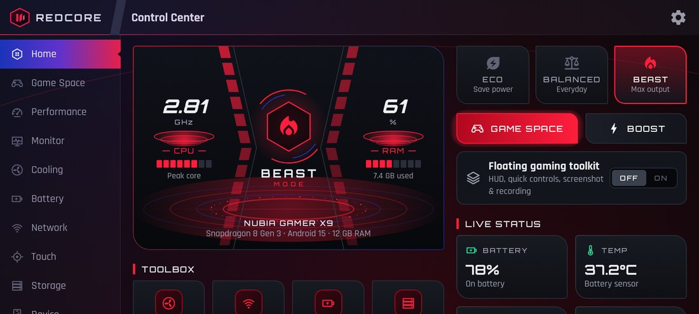
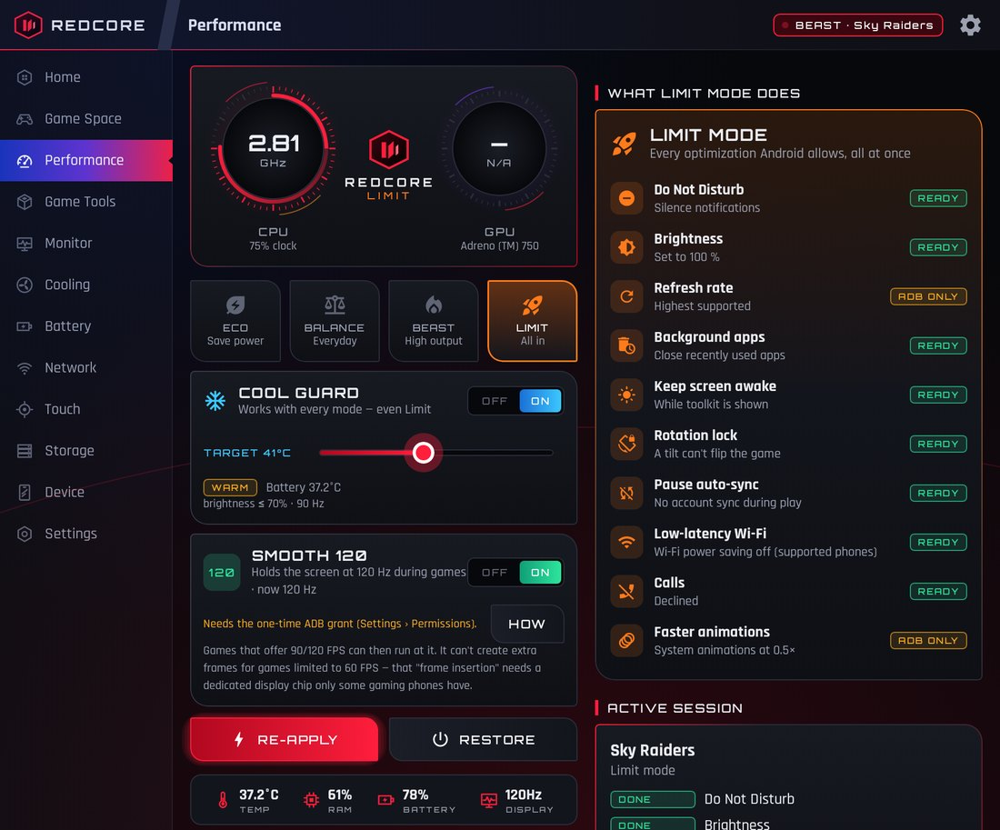
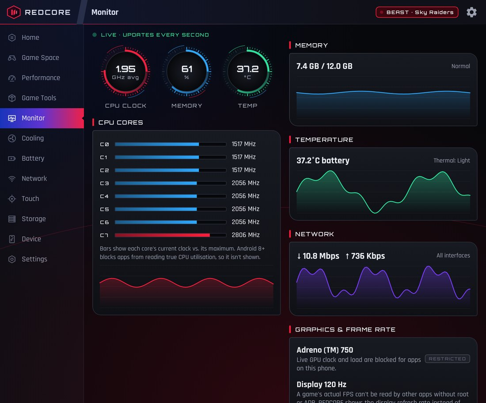
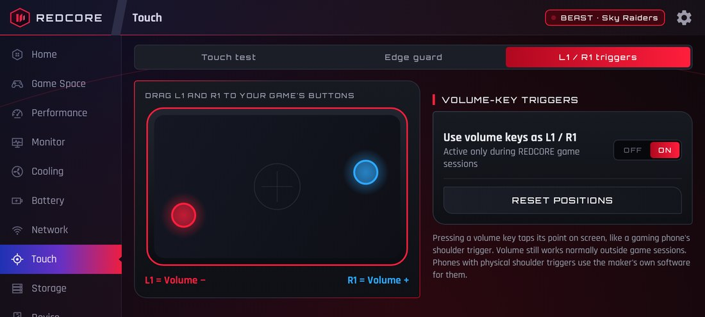
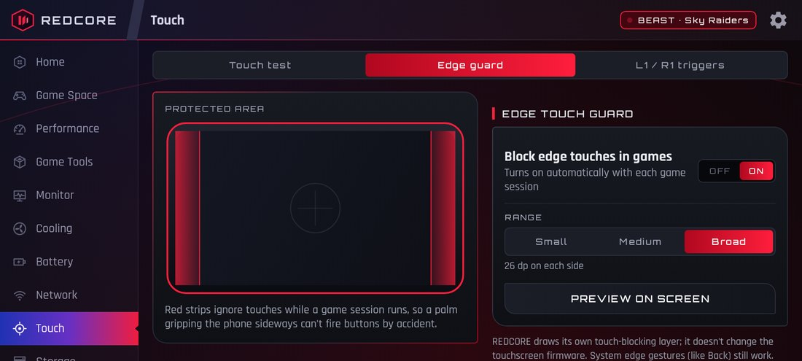
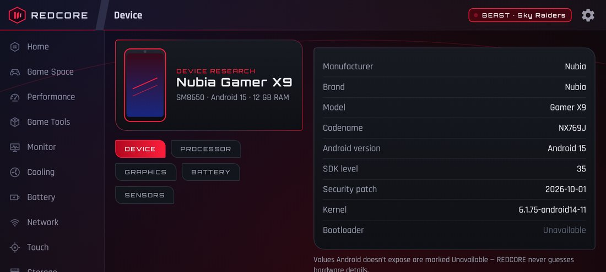

# REDCORE BOOSTER

A gaming control center for Android phones: a game library, real performance modes, a floating in-game toolkit, live hardware monitoring and device research. It's built with Kotlin and Jetpack Compose and runs in landscape like a gaming phone's built-in game space.

REDCORE only shows real readings and only performs actions that Android allows. If a phone doesn't expose something, the app says so instead of showing a made-up number or a switch that does nothing.



| | |
|---|---|
|  |  |
|  |  |
|  |  |
|  |  |
|  |  |

## Features

| Screen | What it does |
|---|---|
| **Control Center** | Live CPU clock and RAM stage, mode selector, quick status, toolbox, recently played games. |
| **Game Space** | 3D game carousel on a neon stage. Finds installed games automatically, and you can add or remove any app. Shows Today/Week play summary rings and a weekly bar chart. Each game has its own profile. |
| **Performance** | CPU and GPU rings, Eco / Balanced / Beast modes, a per-action plan showing what each mode will do and whether it's allowed, results of the active session, background app cleanup, recommendations. |
| **Floating toolkit** | Draggable bubble with a live HUD (CPU, RAM, temperature, battery, network). The expanded panel has modes, Do Not Disturb, screenshot, screen recording (with optional mic), close apps, HUD, edge guard, L1/R1 triggers, brightness and volume sliders, and end session. |
| **Monitor** | Per-core CPU clocks, memory, temperature and network charts, GPU info, and an honest note about FPS. |
| **Cooling** | Temperature gauge, Android thermal status and headroom, history graph, readable thermal zones, fan detection (never a fake fan switch). |
| **Battery** | Level ring, temperature, voltage, current, power, cycles, design capacity, live charts, recommendations. |
| **Network** | Wi-Fi details, a real speed test (Cloudflare), TCP latency/jitter/loss test, live traffic, fixes. |
| **Storage** | Space by category, largest apps, largest media files, safe cleanup guidance. Nothing is deleted automatically. |
| **Touch** | Multi-touch tester that measures the real report rate. **Edge touch guard**: an overlay that blocks palm touches on the side edges during games. **L1/R1 triggers**: Volume −/+ tap two points you choose during game sessions. |
| **Device** | Manufacturer, model, codename, Android/SDK, kernel, chipset, cores and clusters, GPU renderer, OpenGL ES/Vulkan, memory, display modes and refresh rates, battery, storage, sensors, features. |
| **Settings** | Default mode, auto game boost, restore-after-play, toolkit options, units, permission center, limitations. |

### Gaming modes: what they really do

| Action | Eco | Balanced | Beast | Requirement |
|---|---|---|---|---|
| Do Not Disturb (priority only) | – | ✓ | ✓ | Do Not Disturb access |
| Brightness | 40 % | unchanged | 100 % | Modify system settings |
| Refresh rate | lowest | default | highest | One-time ADB grant (see below) |
| Close recently used apps | – | – | ✓ | Usage access |
| Keep screen awake | – | ✓ | ✓ | Display over other apps |
| Edge touch guard / L1-R1 triggers | if enabled | if enabled | if enabled | Overlay / accessibility |

Each game can override any of these. When the session ends, the previous Do Not Disturb, brightness and refresh-rate values are restored.

### What needs root or the phone manufacturer

| Works on every phone | Needs one ADB command | Needs root | Needs manufacturer APIs |
|---|---|---|---|
| Everything listed above | Refresh-rate switching on most phones | CPU/GPU clocks and governors, other apps' FPS, thermal limits, live GPU clock on most phones | Built-in cooling fans, physical shoulder triggers, touch sampling-rate modes, RGB lights |

To enable refresh-rate control (optional, run once with USB debugging on):

```
adb shell pm grant com.redcore.booster android.permission.WRITE_SECURE_SETTINGS
```

## Build

Requirements: **JDK 17 or newer** and the **Android SDK with platform 35** (Android Studio Ladybug or newer includes both).

```bash
# Debug APK  → app/build/outputs/apk/debug/app-debug.apk
./gradlew assembleDebug

# Release APK (minified) → app/build/outputs/apk/release/app-release.apk
./gradlew assembleRelease
```

If you're not using Android Studio, create `local.properties` with `sdk.dir=/path/to/Android/sdk`.

> The release build is signed with the debug key so it installs straight away. Before publishing, create your own keystore and set a `signingConfig` in `app/build.gradle.kts`.

## Install

- **USB:** `adb install -r app/build/outputs/apk/release/app-release.apk`
- **On the phone:** copy the APK to the phone, open it, and allow "Install unknown apps" for your file manager when prompted.

Minimum Android 8.0 (API 26). Tested against Android 15 (API 35).

### First-run setup

Open **Settings › Permissions** and grant what you want to use. Everything is optional.

| Permission | Unlocks |
|---|---|
| Display over other apps | Floating toolkit, HUD, keep-awake, edge guard |
| Usage access | Play-time stats, recently played, auto game boost, background cleanup, per-app storage |
| Do Not Disturb access | Silencing notifications in modes |
| Modify system settings | Brightness in modes and in the toolkit |
| Notifications | Session notification with quick controls |
| Accessibility (Screenshot & triggers) | Toolkit screenshot button, L1/R1 volume-key triggers |
| Media & files | Large-file finder |
| Microphone | Voice in screen recordings |

## Tests

```bash
./gradlew testDebugUnitTest                  # logic tests + screenshot tests
./gradlew recordRoborazziDebug               # re-render every screen to ./screenshots
```

The screenshot tests (Robolectric + Roborazzi) render every screen in landscape with sample data, so you can review the UI without a device.

## Project structure

```
app/src/main/java/com/redcore/booster/
├── data/        Device research, live system monitor, games, usage stats, network, storage, settings (DataStore)
├── booster/     Gaming modes engine (BoostController) and permission helpers
├── overlay/     Floating toolkit service + UI, edge touch guard
├── service/     Auto game detection, accessibility helper (screenshot, L1/R1)
├── record/      Screen recording (MediaProjection)
└── ui/          Theme, components, navigation shell, one file per screen
```

Architecture: MVVM with `StateFlow`. Live sampling runs only while a screen or the overlay is observing it, so nothing polls in the background unless auto game boost is switched on.

## Publishing on Google Play

Some features need policy declarations in the Play Console:

- **QUERY_ALL_PACKAGES**: allowed for apps that need to see installed apps (game launchers qualify, but you must declare it).
- **Accessibility service**: needs a prominent disclosure and Play's accessibility declaration (`isAccessibilityTool="false"`).
- **Foreground service type `specialUse`**: describe the toolkit and game-detection services in the FGS declaration.
- **Usage access** and **WRITE_SETTINGS**: explain in your listing why they're requested.

If you'd rather avoid reviews, you can remove the accessibility features (screenshot button, L1/R1). Everything else is unaffected.

## Credits

The Orbitron and Rajdhani fonts are licensed under the SIL Open Font License (see `fonts-license/`). The REDCORE name, logo and icons are original to this project and aren't affiliated with any phone manufacturer.
